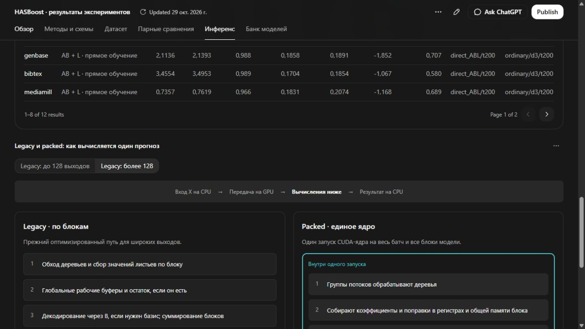

# HASBoost: компактное обучение и инференс

Результаты серии 29 октября 2026 года. Публикация подготовлена 30 октября как продолжение [PR #12](https://github.com/leostre/Py-Boost/pull/12). Новые обучения и GPU-замеры при подготовке PR не выполнялись.

Основной материал для команды — [интерактивная инфографика в HTML](hasboost-results-interactive.html). Скачайте файл и откройте в браузере: все данные и графики встроены. Можно посмотреть отдельный набор, переключить метрику и потолок памяти, сравнить два метода на одних разбиениях, разобрать инференс и состав банка моделей. [Описание разделов и воспроизведение](dashboard-source/README.md).

Раздел «Методы и схемы» поясняет семь семейств и смысл A, B, L. Во вкладке инференса раздельно показаны два вопроса: выигрыш нового кода на одной модели и сравнение разных моделей на одном исполнителе. Ориентир подписан явно, есть схема legacy/packed, пример одного сеанса и абсолютные времена обеих сторон. Девять исходных наборов измерений сохранились без изменений.



Верхняя схема сохранена из [статичной инфографики](figures/hasboost-results-infographic-v1.png), которую также можно вставить в презентацию. HTML разделяет три сравнения: качество разных обученных моделей при одном потолке памяти; исполнение одной функции модели двумя реализациями; один сценарий банка моделей. Схемы поясняющие, точные значения проверяются по [числовому реестру](infographic-claims.json) и CSV. [Промпт исходного изображения](figures/infographic-prompt.md) сохранён; использован встроенный `image_gen`.

## Основные выводы

- При потолке 0,25 B0 прямое обучение AB и AB+L дало средний выигрыш +0,77 и +0,68 п.п. macro-F1 относительно обычного бустинга. Положительное среднее получено на 10 из 12 наборов у обоих методов. B0 — аналитическая координата, а не фактический размер полной модели.
- Новый исполнитель ускорил p95 той же модели AB+L по медиане 12 наборов в 1,94 раза при батче 1 и в 1,27 раза при батче 1024. На большом батче медианный пик собственного пула CuPy снизился на 40,4% относительно прежнего исполнителя.
- Банк из 12 моделей: 5,20 вместо 8,61 МиБ массивов GPU и p95 3,552 вместо 4,378 мс при сопоставимой средней macro-F1. Это один зафиксированный сценарий, а не предел физической вместимости A100.

Результат неоднороден. При 0,7 B0 прямое AB даёт +0,80 п.п. на всех 12 наборах, но −0,07 п.п. на четырёх новых; большую часть общего выигрыша даёт Birds. Обязательный остаток и сложный регулятор не стали универсальным улучшением. У CAL500 даже обычная модель уступает постоянному решению «все метки положительные»; этот диагностический результат сохранён.

## Что входит в код

Все текущие изменения исследовательского снимка после предыдущей публикации перенесены в `research/external_controls`. Карта для ревью:

| Участок | Основные модули |
|---|---|
| Диагностика ошибки и остановка | `abl_increment_diagnostic*`, `abl_stop_rule*`, `abl_stop_continuation*`, `abl_budget_revision*` |
| Общая калибровка и учёт бюджета | `unified_*`, `adaptive_*` |
| Прямые малоранговые приращения | `direct_leaf_*`, `direct_training.py` |
| Банки и управление остатком | `saved_bank_*`, `window_reserve_*`, `reserve_precision_*`, `residual_gate_*` |
| Широкая многометочная серия | `broad_data.py`, `broad_core.py`, `broad_training.py`, `broad_final.py` |
| Единое CUDA-ядро и измерения | `packed_serving_*`, `packed_preflight.py`, `wide_*` |
| Сводка и графики | `two_direction_analysis.py`, `two_direction_figs/` |

[Реестр происхождения кода](../source_manifest.json) содержит исходные и опубликованные SHA. Код взят из `HASBoost-A100-External`, коммит `d339851c2ab943a967dd3123ce64460fb85e8baf`. Основные математические функции перенесены без изменений. Публикационные адаптации ограничены окончаниями строк, безопасной конфигурацией и сохранением запрета автоматического запуска.

## Материалы

- [Обновлённый интерактивный HTML](hasboost-results-interactive.html): графическая схема трёх исполнителей и отдельное сравнение обоих оптимизированных вариантов с исходным Py-Boost. [Новая парная серия S2](native-inference.md) проведена 30 октября без обучения; старые измерения и выводы о качестве сохранены.

- [Краткое ревью и дальнейшие шаги](review.md), [проверки публикационной сборки](publication-verification.json).
- [Полный отчёт](<Итоги двух направлений.md>), [происхождение результатов](provenance.json), [контрольные суммы опубликованных материалов](public-manifest.json).
- [Все 4 941 точки](data/all_quality_points.csv), [1 008 заранее выбранных точек](data/selected_quality.csv), [профили наборов](data/dataset_profiles.csv).
- [Инференс](data/inference_summary.csv), [сравнение представлений](data/representation_comparison.csv), [банки](data/bank_summary.csv).
- [Независимый постоянный контроль](data/constant_diagnostics.csv), [сводка качества](quality_summary.json), [парные ускорения](inference_pairs.json).

## Проверка и воспроизведение

CPU-тесты выполняются из отдельного исследовательского каталога:

```text
cd research/external_controls
python ../../tools/hasboost_cpu_tests.py tests -q
```

Команда ниже из корня репозитория печатает `publication_only` и завершается без установки пакетов, обращения к GPU, загрузки весов или запуска экспериментов:

```text
python research/external_controls/external_runner.py
```

Для повторения научного запуска нужно отдельно восстановить исходные данные, модели, закреплённые входы и конфигурацию соответствующего исходного коммита. Пути `${HASBOOST_ARTIFACTS}`, `${HASBOOST_NATIVE_RUNTIME}` и `${HASBOOST_EXTERNAL_RUNTIME}` в опубликованной конфигурации — явные места восстановления, а не автоматически подставляемые переменные. Личное согласие на лицензию TabPFN не переносится: `tabpfn_weights_authorized=false`.

Данные, разметка объектов, индексы разбиений, веса, модели и среды не публикуются. Исторические реестры конкретных запусков также не выдаются за переносимые настройки. Сохранены метаданные источников наборов; для загрузки нужно учитывать условия их распространения. Наличие кода не означает готовности единого публичного API всех исторических фаз.

Графики можно перестроить только из опубликованных CSV, без моделей:

```text
python research/external_controls/two_direction_figs/plot_results.py docs/research/2026-10-29/data results/hasboost-figures
```

Нужны NumPy и Matplotlib с поддержкой внешней легенды. PNG инфографики — отдельная иллюстрация; научные графики поставляются в SVG/PDF.

## Границы оценки

Три train/D-разбиения используют общий тест, поэтому их разброс не является доверительным интервалом независимых тестов. Восемь наборов имеют исторически использованный тест; Enron, CAL500, Corel5k и Delicious оценены впервые после фиксации серии. Пороги меняют решения, а не вероятности; для многометочных задач T=1.

GPU-результаты относятся к исходному снимку на A100 и не повторялись на публикационной сборке. Метаданные условий и исходные SHA сохранены. Ускорение всего обучения, универсальное преимущество над CatBoost/XGBoost/TabPFN и эксплуатационный SLA этой серией не установлены.
