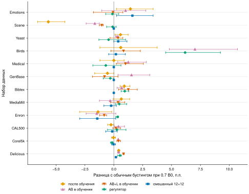
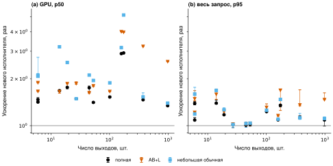

# Два направления HASBoost: результаты автономной серии

Проверены 12 многометочных наборов и 36 разбиений обучающего пула. Число проверенных представлений — 4941. Расход новых деревьев с учётом предварительных проверок — 38904 при пределе 42 000. Для каждого метода сохранены модели, прогнозы, калибровка и контрольные суммы.

D — общая отложенная часть нетестовых данных. Деревья учатся на train; для оценки калибровки каждый объект D получает решение с порогами, подобранными на другом блоке D. Итоговые пороги переоцениваются на всей D, а окончательное качество измеряется на отдельном фиксированном тесте.

## Что означает результат по бюджету

Ниже сопоставлены все заранее заданные семейства при одном потолке 0.7 B0. Указана разница тестовой macro-F1 с обычным бустингом, выбранным на D при том же потолке. Положительное среднее не является проверкой статистической значимости. Последний столбец отдельно показывает Enron, CAL500, Corel5k и Delicious; выбор по тесту для них не проводился.

| Семейство | Средняя разница на 12 наборах, п.п. | Положительное среднее | Среднее на четырёх новых наборах, п.п. |
|---|---:|---:|---:|
| AB в обучении | +0.80 | 9/12 | -0.07 |
| AB+L в обучении | +0.21 | 8/12 | +0.15 |
| Регулятор | +0.57 | 6/12 | +0.24 |
| Сжатие после обучения | -0.27 | 7/12 | -0.30 |
| Смешанный 12+12 | +0.04 | 4/12 | -0.35 |
| SketchBoost | -0.18 | 4/12 | +0.05 |

AB и AB+L обучались по разным траекториям обратной связи. Их различие нельзя целиком приписать добавлению одного готового остатка. Эта серия меняла его бюджет 0/2/5%; отдельная шкала ослабления R4 на всех 12 наборах не повторялась.

При потолке 0.7 B0 смешанный каталог дал среднюю разницу с небольшими обычными бустингами +0.04 процентного пункта macro-F1. Положительное среднее изменение получено на 4 из 12 наборов. Это сравнение выбранных на D моделей, а не выбор лучшей точки по тесту.

Смешанный каталог содержит обычные и послеобучающие представления. Его положительный результат сам по себе не доказывает пользу малорангового базиса: в таблице ниже отдельно указано, сколько раз он выбрал такой базис. Полноранговое представление с меньшим числом листьев относится к управлению структурой; его нельзя выдавать за результат низкого ранга.

| Набор | Разница macro-F1, п.п. | Разброс трёх разбиений | Выборов с базисом | Выборов с остатком |
|---|---:|---:|---:|---:|
| Emotions | +1.61 | +0.24 … +3.40 | 2/3 | 2/3 |
| Scene | +0.00 | +0.00 … +0.00 | 0/3 | 0/3 |
| Yeast | +0.38 | +0.00 … +1.14 | 1/3 | 1/3 |
| Birds | +0.18 | -0.44 … +1.00 | 0/3 | 0/3 |
| Medical | +0.00 | +0.00 … +0.00 | 0/3 | 0/3 |
| GenBase | +0.00 | +0.00 … +0.00 | 2/3 | 2/3 |
| Bibtex | +0.00 | +0.00 … +0.00 | 0/3 | 0/3 |
| MediaMill | -0.23 | -0.86 … +0.22 | 3/3 | 1/3 |
| Enron | -1.43 | -2.95 … +0.17 | 0/3 | 0/3 |
| CAL500 | -0.14 | -0.70 … +0.29 | 0/3 | 0/3 |
| Corel5k | -0.02 | -0.20 … +0.15 | 3/3 | 2/3 |
| Delicious | +0.18 | +0.13 … +0.24 | 3/3 | 3/3 |

Средние точки и отрезки показывают среднее и полный разброс трёх разбиений train/D. Это не доверительные интервалы; тест у разбиений общий. У каждого семейства не более 24 обращений к D. В смешанном каталоге общий предел также 24: 12 обычных и 12 послеобучающих вариантов.

Дополнительный контроль: обычная модель, выбранная при B0, превосходит по macro-F1 постоянное решение «все метки положительные» в среднем на 11 из 12 наборов. Это отдельная диагностика абсолютного качества, без новых деревьев и без участия в отборе. Для разреженных меток macro-F1 следует читать вместе со взвешенной F1 и NLL; все три сохранены в таблицах.

## Что означает результат по инференсу

Для полной модели на батче 1024 новый исполнитель по медиане наборов выполняет GPU-стадию быстрее в 1.51 раза; p95 полного запроса — быстрее в 1.11 раза. Здесь сравнивается одна и та же функция модели на двух исполнителях; результат относится к коду инференса.

Если сравнить AB+L с полной моделью уже на новом исполнителе, при 200 деревьях медианное отношение объёмов постоянных массивов равно 0.690, а p95 полного запроса у гибрида — медленнее в 1.01 раза. Качество этих моделей различается; полный разбор каждого набора и батча приведён в representation_comparison.csv. По одному отношению памяти нельзя утверждать, что гибрид быстрее.

На рисунке: одна сохранённая модель на набор, батч 1024; три сеанса по 32 парных запроса в перемешанном порядке. Отрезки показывают разброс отношения времени по трём сеансам. Слева — GPU, справа — запрос с передачами и возвращением вероятностей и меток на CPU. Параметры float32, накопления и вероятности float64 у обоих исполнителей.

## Банки моделей

| Банк, новый исполнитель | Моделей | Массивы GPU, МиБ | Пик собственного пула, МиБ | Средняя macro-F1 | p95 запроса, мс |
|---|---:|---:|---:|---:|---:|
| mixed2470 | 12 | 5.20 | 15.83 | 0.3253 | 3.552 |
| full200 | 12 | 11.36 | 21.98 | 0.3250 | 4.685 |
| ordinary70 | 12 | 8.61 | 19.23 | 0.3225 | 4.378 |

Все модели банка действительно размещены одновременно. Небольшой обычный и смешанный банки отбирались при одном общем потолке памяти по качеству на D. Отбор использовал четыре уже зафиксированные точки бюджета каждой задачи; новые обращения к D не добавлялись. Полный банк служит отдельным ориентиром. Если оба банка помещаются на A100, это подтверждает экономию байтов; максимальное число различных задач этим опытом не установлено.

## Что реализовано

- Общая схема train/D без отдельных выборок для каждого порога: два блока по группам признаков, одинаковые правила для всех методов, итоговые пороги по всей D. Температура многометочных выходов T=1; настройка порогов меняет решения, а не вероятности.
- Обычные модели глубины 3 и 5, SketchBoost, прямое обучение AB и AB+L, послеобучающее управление листьями/рангом/остатком и регулятор с реальной обратной связью. Остаток может отсутствовать. Для прямого обучения квота поправок переносится между деревьями.
- Упакованный исполнитель для нескольких базисов: обход, сбор коэффициентов, остаток, декодирование, пороги и вероятности в одном CUDA-ядре. Нет глобальных промежуточных матриц «батч × ранг», «батч × остаток» и отдельного выхода на каждый блок. Полная модель получает ту же оптимизацию.
- Для широких выходов рассчитываются первые 64 направления взвешенного базиса. Полный выход остаётся контролем. Проверены численные инварианты, экспорт моделей, калибровка и фактические начальные прогнозы каждого следующего участка обучения.

## Границы выводов

Восемь наборов используют уже виденный исторический тест и дают исследовательскую оценку. Enron, CAL500, Corel5k и Delicious впервые оценены после фиксации этой серии. Для Enron и CAL500 тест выделен по признакам без использования меток; для двух остальных сохранено исходное разбиение хранилища KDIS. Дубликаты признаков не пересекают train/D/test. У MediaMill сохранён прежний тест, один совпавший с ним обучающий объект исключён; используется прежняя когорта, а не весь исходный набор.

B0 — аналитическая координата памяти, рассчитанная до обучения. 0.7 B0 не означает автоматически 30% экономии относительно фактически обученной полной модели. В CSV приведены абсолютные байты и оба отношения. Память модели отделена от входов, выходов и пика собственного пула CuPy. Сторонний контекст A100 в наши байты не включён; окружения сохранены.

Столбец parameters сохраняет прежний счётчик коэффициентов, смещений и калибровки. Число внутренних узлов дано отдельно в nodes; поля структуры полностью включены в байты. Поэтому выводы об экономии памяти не зависят от трактовки числа обучаемых параметров.

При батче больше D строки повторяются. Эти измерения характеризуют стенд, а не произвольный поток запросов. p95 оценён по 96 запросам, включая три сеанса; это не проверка эксплуатационного SLA. Для каждого нового исполнителя подбор схемы шёл на отдельных замерах D до итогового сравнения.

Сетка порогов фиксирована и одинакова для всех методов. В профилях дополнительно отмечены метки, для которых ни один положительный объект D не достигает её нижней границы. Это диагностирует ограничение калибровки без новых настроек; его нельзя автоматически приписывать плохому базису. Адаптивная сетка здесь не проверялась.

Глубины ограничены 3/5 и 200 деревьями; прямой малоранговый ранг ограничен 64. Это границы проверенного каталога, а не доказательство мирового оптимума или превосходства над всеми настройками CatBoost/XGBoost. История G/H, параллельные ветви обучения, TabPFN и перенос в другие проекты в эту серию не входили.

## Материалы для проверки

- [Все точки качества](data/all_quality_points.csv), [зафиксированный отбор](data/selected_quality.csv), [профили данных](data/dataset_profiles.csv).
- [Постоянные диагностические контроли](data/constant_diagnostics.csv): решения фиксированы, вероятности взяты из частот обучающей выборки.
- [Замеры моделей](data/inference_summary.csv), [сравнение представлений](data/representation_comparison.csv), [реальные банки](data/bank_summary.csv).
- [Сводка качества](quality_summary.json), [парные ускорения](inference_pairs.json), [происхождение и первичные запуски](provenance.json).

Кривые каждого набора сохраняют все измеренные варианты бледными точками. Выделенные точки выбраны только по D; линии лишь соединяют эти точки и не означают измерение промежуточных моделей. Отрезки показывают разброс трёх разбиений. Непрошедшие малый бюджет варианты не скрываются из полной таблицы.

- [Emotions: качество и память](figures/budget-emotions.svg)
- [Scene: качество и память](figures/budget-scene.svg)
- [Yeast: качество и память](figures/budget-yeast.svg)
- [Birds: качество и память](figures/budget-birds.svg)
- [Medical: качество и память](figures/budget-medical.svg)
- [GenBase: качество и память](figures/budget-genbase.svg)
- [Bibtex: качество и память](figures/budget-bibtex.svg)
- [MediaMill: качество и память](figures/budget-mediamill.svg)
- [Enron: качество и память](figures/budget-enron.svg)
- [CAL500: качество и память](figures/budget-cal500.svg)
- [Corel5k: качество и память](figures/budget-corel5k.svg)
- [Delicious: качество и память](figures/budget-delicious.svg)
