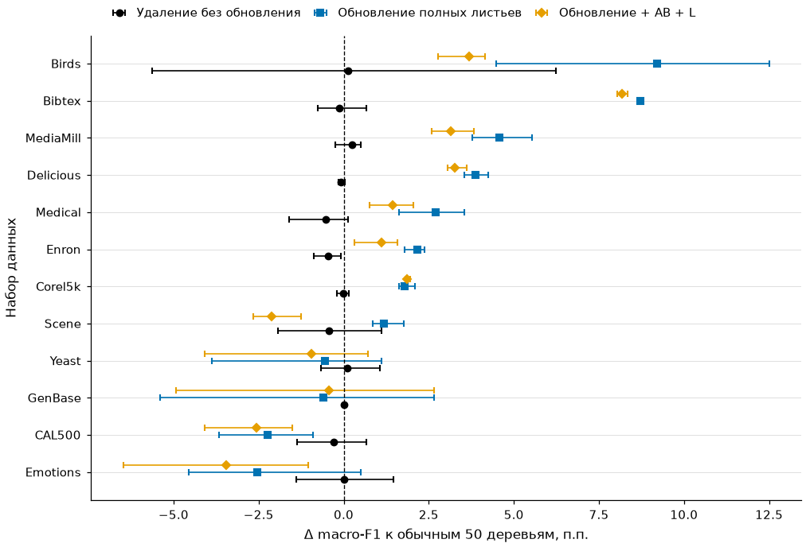
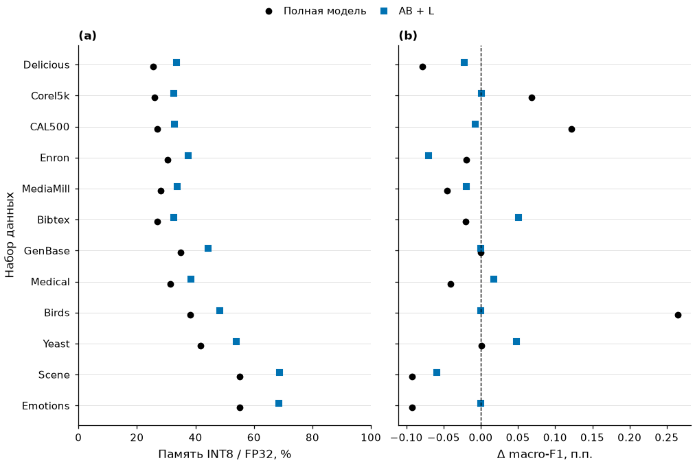

# HASBoost: результаты шести направлений

[Методологическая история: почему появились эти проверки и как менялись гипотезы](../methodology/README.md) · [Интерактивный прототип прежнего среза](../2026-10-29/hasboost-results-interactive.html).

Снимок `checks.json` ниже относится к публикационной сборке до отдельной редакции HTML. [Проверки методологического документа и новой визуальной редакции](../methodology/checks.json) сохранены отдельно; прежние числовые отчёты не пересчитывались.

Экспериментальная серия — 30 октября 2026 года; материалы для ревью оформлены 2 ноября 2026 года.

Все шесть пунктов автономной программы выполнены. Проверены **12 многометочных наборов на 36 прежних разбиениях**, отдельно — пять прежних задач классификации для сравнения с TabPFN. Построено **21 600 новых деревьев**, проведены 288 перенастроек листьев на фиксированных структурах, проверены 864 структурных представления. GPU после завершения запусков освобождена.

Самый полезный результат серии: сокращение числа деревьев с обновлением оставшихся листьев оказалось сильным самостоятельным методом. Общий базис и поправки дают дополнительный обмен качества на память, но их преимущество нужно проверять относительно этого усиленного обычного контроля. Квантование существенно уменьшает хранение; ускорение зависит от исполнения и размера запроса.

Все числа ниже получены из закреплённых отчётов OpenResearch. Это продолжение исследования на уже знакомых тестах. Три разбиения каждого набора используют общий тест; они не считаются тремя независимыми датасетами. Повторяющиеся архивные модели также не выдаются за новые обучения. Подробные точки и источники — в [CSV и реестре результатов](summary.json), развилки — в [журнале решений](decisions.md).

**1. Сравнение при близком фактическом размере.** Для AB и AB + L подобраны обычные Py-Boost-модели, чьи массивы для исполнения отличаются по размеру не более чем на 5%. Эти 5% относятся к памяти, а не к допустимой потере качества. Получены все 288 запланированных пар, включая повторное использование одинаковых архивных точек.

Здесь названия AB и AB + L обозначают прежние семейства прямого обучения: первые 40 деревьев у них сохраняют полные листья. Во втором направлении отдельно проверяется сжатие этого начала. В третьем направлении сжимаются все оставленные деревья; это другое представление, и его размер считается заново.

Для прежней группы отбора 0,5 B₀ средняя разница macro-F1 составила **+1,355 п.п. для AB**, положительный средний результат — на 11 из 12 наборов. Для AB + L — **+0,472 п.п.**, положительный результат на восьми наборах. То есть полезный эффект общего базиса сохранился после усиления обычного контроля. Считать AB + L обязательным улучшением AB оснований нет.

Простая попытка предсказать выигрыш по числу выходов, плотности меток и концентрации спектральной энергии не дала надёжного общего правила. Число выходов полезно для расчёта размера представления, но само по себе не выбирает лучший метод по качеству.

**2. Компактное начало настоящего обучения.** Проверены полный старт из 40 деревьев, старт из 20, сжатие прежнего старта и управление остатком при продолжении. После выбора поправок следующее дерево действительно получает прогноз выбранной компактной модели.

Фиксированный сжатый старт AB + L затем проверен на всех 36 разбиениях. В среднем он занял **81,61% памяти прежнего AB + L**, средняя разница macro-F1 — **−0,052 п.п.** Диапазон по разбиениям — от −2,369 до +2,728 п.п. Экономия воспроизводится лучше, чем знак изменения качества.

Событийное ослабление и пропуск остатка не стали общим победителем. Для них был добавлен контроль с таким же делением обучения на четыре блока; дополнительные обращения к D учитываются: 12 у управляемого варианта против четырёх у фиксированного. Время продолжения не выдаётся за полное время обучения с нуля.

**3. Структурное сокращение.** Удаление деревьев без обновления листьев в среднем не помогло. Перенастройка коэффициентов оставшихся листьев дала заметно более сильный результат. Использовались только обучающие объекты: цель обновления — смесь истинной разметки и вероятностей полной модели в равных долях, два прохода с проверкой убывания обучающей функции потерь.

Средние результаты по 12 наборам и трём разбиениям каждого:

| Представление | Память относительно исходной полной модели из 200 деревьев | Δ macro-F1 к этой полной модели |
|---|---:|---:|
| Обычный префикс, 50 деревьев | 25,7% | −2,861 п.п. |
| 50 выбранных деревьев, обновление полных листьев | **26,0%** | **−0,506 п.п.** |
| 50 деревьев, обновление + AB + L | 16,8% | −1,766 п.п. |
| То же с укрупнением листьев | 10,4% | −2,788 п.п. |
| 200 деревьев, обновление полных листьев | 100,0% | +0,579 п.п. |
| 200 деревьев, обновление + AB + L | 57,9% | −0,471 п.п. |

Это поддерживает исходную идею о лишней сложности ансамбля. При этом существенную часть эффекта обеспечивает обновление листьев. Дополнительная польза самого правила выбора деревьев после одинакового обновления ещё не отделена: для этого нужен контроль «обычный префикс + такое же обновление».

На рисунке — изменение macro-F1 относительно обычных 50 деревьев; точки показывают среднее трёх разбиений, отрезки — их минимум и максимум, **не доверительный интервал**. Видна неоднородность: например, обновление полезно на Birds и Bibtex, но ухудшает результаты на части малых наборов.

Реализация использует принцип удаления с последующим обновлением листьев, связанный с [LOP, ICML 2025](https://proceedings.mlr.press/v267/devos25a.html). Это самостоятельная адаптация; точное воспроизведение и сравнение с оригинальным LOP не выполнялись.

**4. Инференс и сильный внешний контроль.** Сравнены packed, отдельный сбор координат с GEMM и исходный Py-Boost из актуального `master @ b2842af`. Деревья для этих измерений не переобучались. Все 180 решений по предварительным запросам выбрали packed. В проверенном диапазоне число выходов — до 983, батч — до 4096; преимущества отдельного сбора с GEMM не обнаружено.

Для одной и той же полной модели медиана ускорения packed относительно исходного Py-Boost по 12 наборам:

| Батч | Стадия с данными на GPU, p50 | Полный запрос, p95 |
|---:|---:|---:|
| 1 | 41,51× | 20,48× |
| 32 | 41,88× | 18,52× |
| 256 | 43,57× | 9,91× |
| 1024 | 35,57× | 4,88× |
| 4096 | 14,64× | 2,00× |

GPU-стадия измерена CUDA-событиями вокруг исполнителя с уже загруженными объектами. Это не сумма времени отдельных ядер: сохраняются собственные выделения памяти и организация вызовов соответствующего исполнителя. Полный запрос включает передачи между CPU и GPU.

Дополнительно проверен nvForest 26.10 в отдельной закреплённой среде. Он получает ту же полную модель с векторными листьями; деревья не размножаются по выходам. Для сильного контроля вычисление вероятностей, меток и ограничения диапазона также объединено в CUDA-ядро.

После этого преимущество packed по полному запросу стало существенно скромнее: при батче 1024 отношение p95 nvForest single / packed — **1,006**, то есть практически равенство; при 4096 — **0,830**, в пользу nvForest. GPU-стадия packed при этих батчах короче примерно в 2,00 и 1,81 раза. Полная задержка зависит также от обработки входов, вызовов API и передач данных. Универсальное превосходство packed над сильным внешним исполнителем не установлено.

Каждое сочетание layout/chunk/батча nvForest проверялось до настройки времени. Восемь сочетаний дали численно неверный результат и исключены. Для 983 выходов и батча 1 не осталось проверенного double-режима из рассмотренных шести; single доступен. Точная причина несовпадений отдельно не установлена. Финальные запросы допустимых сочетаний прошли численную проверку.

**5. Квантование.** Проверены FP16 и INT8 для A, B и полного начального участка, а также их раздельное влияние. Остаток L, смещения и пороги сначала оставлены FP32; масштабы, индексы и выравнивание входят в размер. Сжатые коэффициенты читаются ядром непосредственно из GPU-массивов.

Для прежнего AB + L на первых разбиениях 12 наборов:

| Формат | Средняя память параметров относительно FP32 | Средняя Δ macro-F1 при прежних порогах |
|---|---:|---:|
| FP16 | 62,4% | +0,0002 п.п. |
| INT8 | 43,7% | −0,0050 п.п. |

Наихудшее изменение macro-F1 у INT8 AB + L — −0,0699 п.п. Обычная полная модель также хорошо квантуется: в среднем остаётся **35,0%** её исходных массивов. Поэтому сравнения содержат обычный INT8-контроль.

На рисунке каждая модель сравнивается со своей FP32-версией. Это **одно разбиение на набор**, интервал неопределённости не изображён. Слева — отношение размеров, справа — изменение macro-F1 при фиксированных порогах.

Аппаратное преобразование FP16 проверено на всех 63 488 конечных битовых представлениях, включая знак нуля. Для INT8 постоянные масштабы вынесены из внутренних циклов. После этой оптимизации скорость FP16 почти совпала с FP32. INT8 у AB + L при батче 1024 всё ещё имел отношение скоростей FP32 / INT8 **0,783 на GPU** и **0,972 для полного запроса**. Экономия памяти не означает автоматического ускорения.

Рабочие массивы запроса также ограничивают эффект сжатия. Для AB + L медиана отношения собственного пика INT8 / FP32 составила около **40,0% при батче 1**, но **96,0% при 1024**. Выходы и входы большого батча занимают память независимо от формата коэффициентов модели.

Продолжение обучения с квантованным прогнозом проверено отдельно. После округления B штраф в пространстве значений листьев требует метрики λ BᵀB; эта корректировка реализована и проверена независимой квадратичной задачей. По правильной метрике среднее изменение macro-F1 относительно обычного продолжения с последующим квантованием — **−0,522 п.п. для FP16 и −0,225 п.п. для INT8**. Устойчивого выигрыша не получено; ветка пока не продвигается. Предварительные результаты с прежней метрикой сохранены отдельно и не используются как основной положительный результат. Переносился принцип компенсации ошибки следующими деревьями из [FQTree](https://arxiv.org/abs/2608.12140); их FPGA-ускорения на A100 не переносились.

**6. Банки моделей.** Выполнены 240 проверок общего бюджета при батчах 32/1024, конкурентности 1/4/8 и двух распределениях запросов. Во всех завершённых точках соблюдён бюджет моделей и рабочих буферов. Для сравниваемых банков использовались одинаковые последовательности задач. Отдельно сохранены время обслуживания, задержка с очередью и пропускная способность; короткие серии по 32 запроса не считаются подтверждением производственного SLA.

Пример: равномерные запросы, батч 32, конкурентность 1, одна и та же верхняя граница бюджета:

| Банк | Средний macro-F1 по задачам | Размещённые массивы с выравниванием |
|---|---:|---:|
| Обычный INT8 | 0,32383 | 2,691 МБ |
| Обычный INT8 с обновлением листьев | **0,33731** | 2,756 МБ |
| Компактный каталог | 0,32985 | 2,007 МБ |
| Смешанный каталог 24 | 0,33190 | **1,648 МБ** |
| Объединённый каталог 46 | 0,33478 | 2,731 МБ |

Более широкий каталог улучшает целевую функцию на D, но не гарантирует улучшения на тесте. Его объём отбора больше, что явно учтено. Смешанный банк экономит память, но уступает усиленному обычному банку по среднему качеству; это обмен, а не безусловное преимущество.

При прикладном бюджете 64 МиБ физически размещены 276 копий моделей усиленного обычного банка или 468 копий смешанного. Качество этих банков различается, поэтому это не сравнение вместимости при тождественном качестве. Различных задач по-прежнему 12. Нагрузка на все тысячи копий не измерялась; проверялось фактическое размещение и резерв рабочих буферов. Служебная память CUDA-контекста не входит в этот прикладной бюджет.

**Отдельная проверка TabPFN.** Использованы прежние Helena, MNIST, RT-IoT2022, WDBC и Banknote. TabPFN — cached auto с восемью оценщиками и общими весами; подготовка пяти контекстов заняла 20,86 с, обновлений весов нейросети нет. На равномерном потоке при батче 32 p95 составил **335,93 мс**, у сохранённого полного бустингового банка — **0,347 мс**. Это конкретные готовые конфигурации и короткие серии, без выравнивания их качества.

| Задача | Полный бустинг FP32, macro-F1 | TabPFN, macro-F1 |
|---|---:|---:|
| Helena | 0,1437 | 0,2006 |
| MNIST | 0,9332 | 0,9723 |
| RT-IoT2022 | 0,8952 | 0,8827 |
| WDBC | 0,9260 | 0,9719 |
| Banknote | 0,9890 | 1,0000 |

В WDBC и Banknote прежний posthoc-контроль тождествен полному: при двух классах представление с C−1 уже имеет ширину один. Эти задачи не выдаются за успех малорангового сжатия. Для TabPFN используются собственные счётчики PyTorch; принадлежность PID из `nvidia-smi` не была подтверждена, поэтому показания этого PID не используются как доказательство расхода нашей GPU-памяти. Для бустинга измерялись собственные массивы и пул CuPy. Время прежнего обучения деревьев не включено в задержку обслуживания.

**Что развивать после ревью.** Наиболее обоснован следующий шаг: общий выбор между сокращением структуры, обновлением полных листьев, AB + L и точностью хранения при фактическом бюджете и ограничении задержки. Его обязательный обычный контроль — сокращение с таким же обновлением листьев и квантованием. Дополнительную пользу выбора деревьев стоит отделить от пользы обновления, а затем подтвердить границы на новых тестах. Для инференса полезнее выбирать исполнителя и формат по целой задержке запроса и рабочей памяти, чем ориентироваться на ускорение одного GPU-участка. Квантованное продолжение и управление остатком пока не имеют достаточного общего преимущества для следующей большой серии.

В [реестре](input_manifest.json) закреплены исходные отчёты и SHA-256. Все точки, включая неудачные, сохранены. Только одна структурная точка опустилась ниже половины macro-F1 исходной полной модели: Corel5k, первое разбиение, удаление до 50 деревьев без обновления. Она не удалена из данных.

Графики доступны также в SVG/PDF. Они проверены визуально; используется DejaVu Sans из закреплённой среды, поскольку издательский шрифт Helvetica/Arial в ней отсутствует. Окружения и шрифты при подготовке результатов не изменялись.

**Материалы для ревью.** [Карта кода и воспроизведение](../../../research/external_controls/SIX_DIRECTIONS.md), [проверки публикационной сборки](checks.json), [11 таблиц CSV](data/), [закреплённые отчёты](reports/) и [контрольные суммы опубликованных отчётов](source_manifest.json). В окончательной сборке прошли 38 CPU-проверок; оба публикационных входа завершаются до работы с GPU. Это не повторный запуск серверной серии. Приёмка результатов и слияние изменений остаются отдельными этапами.
