# Визуализации HASBoost: методы, гипотезы и результаты

Собраны ранее подготовленные изображения; их содержимое не изменялось. Выбраны исправленные версии H-LR2/H-LR3 и схемы от 20 октября. Концептуальные рисунки созданы генератором изображений в прежних сессиях; графики результатов построены стандартными средствами по завершённым сериям. При переносе новые изображения и результаты не генерировались.

**Схема объясняет механизм, но не доказывает выигрыш.** Порядок траекторий, условные спектры и кривые допустимости в концептуальных рисунках не являются измерениями. Состояние гипотез и отрицательные результаты приведены в [основном реестре](../README.md). Точные определения и ограничения в подписях ниже имеют приоритет над сокращениями внутри старых рисунков.

Для всех схем: M — суммарные листья, C — выходы, r — ранг, s — число поправок. Компактное представление определяется равенством Ṽ = ABᵀ + L, а исходная полная V лишь приближается им. L и S в разных рисунках обозначают разреженный остаток. Индексы объектов, признаков и выходов имеют разные назначения.

| Схема | Связанные PR |
|---|---|
| [История и подпространство выходов](#rmt-output-subspace) | [#3](https://github.com/leostre/Py-Boost/pull/3), [#4](https://github.com/leostre/Py-Boost/pull/4) |
| [Ранняя активация и риск изменения разбиения](#scheduler-risk) | [#6](https://github.com/leostre/Py-Boost/pull/6) |
| [H-LR1: общий базис значений листьев](#shared-leaf-basis) | [#7](https://github.com/leostre/Py-Boost/pull/7) |
| [Функциональная геометрия: базис по суммарным прогнозам](#functional-geometry-v2) | [#7](https://github.com/leostre/Py-Boost/pull/7), [#10](https://github.com/leostre/Py-Boost/pull/10) |
| [H-LR3: больше деревьев при сопоставимом бюджете](#matched-budget-v2) | [#10](https://github.com/leostre/Py-Boost/pull/10) |
| [H-LR4: общий базис и разреженные поправки](#sparse-corrections) | [#7](https://github.com/leostre/Py-Boost/pull/7) |
| [Обход деревьев и распределение работы CUDA](#traversal-v2) | [#8](https://github.com/leostre/Py-Boost/pull/8) |
| [Совместное управление листьями, рангом и остатком](#joint-budget-v2) | [#10](https://github.com/leostre/Py-Boost/pull/10) |
| [Сжатие после обучения и компактная обратная связь](#online-training-v2) | [#9](https://github.com/leostre/Py-Boost/pull/9) |
| [Текущий сигнал, среднее и история матриц Грама](#history-v2) | [#9](https://github.com/leostre/Py-Boost/pull/9) |
| [Параллельные приращения и общий базис](#parallel-branches-v2) | [#9](https://github.com/leostre/Py-Boost/pull/9) |
| [Память представления, запроса и нескольких моделей](#serving-memory-v2) | [#8](https://github.com/leostre/Py-Boost/pull/8), [#11](https://github.com/leostre/Py-Boost/pull/11) |

Измеренные графики всех пяти задач:

- [H-QB1: бюджет, усиление моделей и TabPFN](results-qb1.md).
- [H-CAL1: объём данных, температура и отбор](results-cal1.md).

Для точных GPU-редукций в пакете 03 отдельного готового рисунка нет; общие схемы метода не заменяют проверок счётчиков, гистограмм и порядка суммирования.

## Происхождение

[Реестр файлов](manifest.json) содержит исходные относительные пути, SHA-256, размеры и назначения. Концептуальные PNG и графики PNG/SVG перенесены побитно. Статус прежней научной проверки взят из исходных заметок; это не новый прогон экспериментов.

## rmt-output-subspace

**История и подпространство выходов.** Иллюстрация механизма или гипотезы. [PR #3](https://github.com/leostre/Py-Boost/pull/3), [PR #4](https://github.com/leostre/Py-Boost/pull/4).

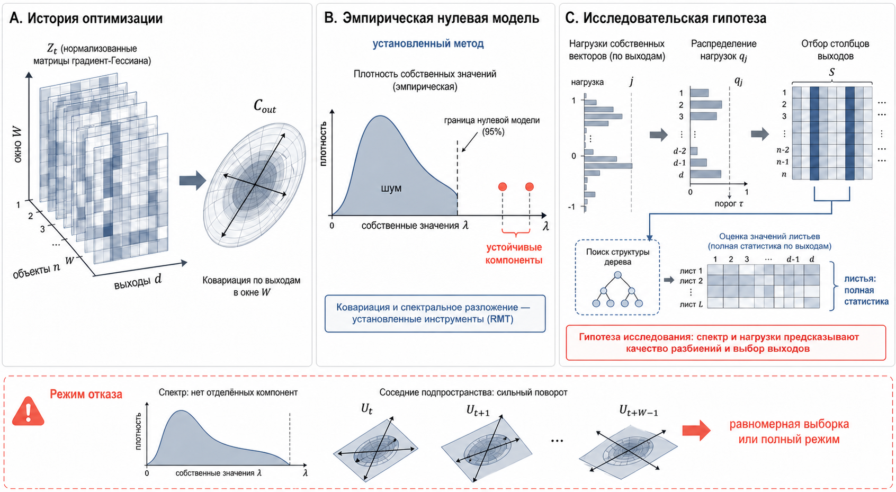

Историческая исследовательская постановка. В правой нижней части показано разделение поиска структуры по сокращённым выходам и окончательной оценки листьев по полной статистике. Это относится к исправлению индексов; ковариация и правило выбора выходов — отдельные гипотезы. Обозначения n/d на старой схеме не являются именами индексов API: строки — объекты, столбцы — выходы; признаки образуют отдельную ось. Граница 95% иллюстративна и не обещает такой частоты ошибок для G/H.

## scheduler-risk

**Ранняя активация и риск изменения разбиения.** Иллюстрация механизма или гипотезы. [PR #6](https://github.com/leostre/Py-Boost/pull/6).

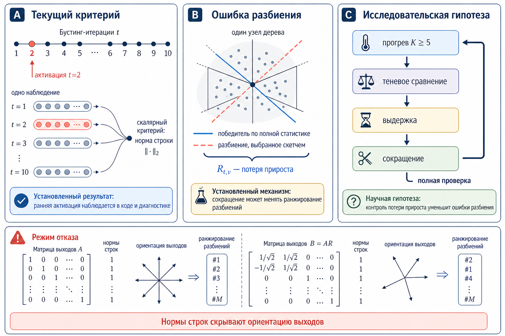

Схема объясняет, почему одна норма строки может скрыть ориентацию выходов. Активация на второй итерации относится к исходному правилу, а K ≥ 5 — пример прогрева в старой постановке, не текущая настройка по умолчанию. Ранжирование кандидатов в нижней панели схематично. Событийный детектор оценивается по своему протоколу при равном числе проверок; положительный исход по рисунку не предполагается.

## shared-leaf-basis

**H-LR1: общий базис значений листьев.** Иллюстрация механизма или гипотезы. [PR #7](https://github.com/leostre/Py-Boost/pull/7).

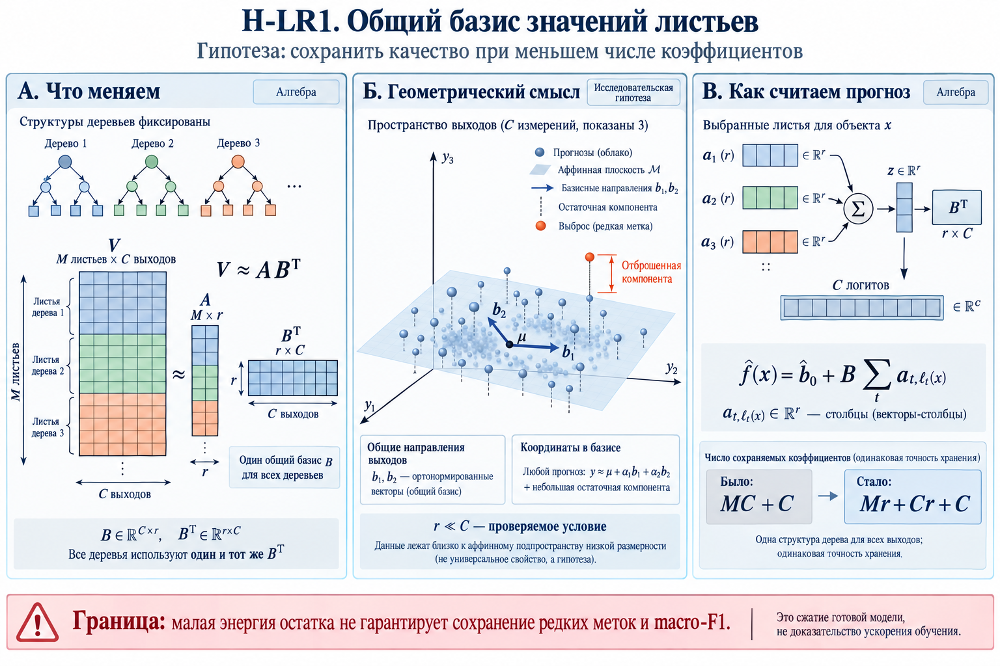

Структуры деревьев сохраняются, а полные векторы листьев заменяются коэффициентами в одном базисе выходов. При прогнозе сначала суммируются достигнутые строки A, затем применяется B. Плоскость — геометрическая иллюстрация, а не измеренный спектр конкретного набора; экономия коэффициентов сама по себе не доказывает ускорения.

## functional-geometry-v2

**Функциональная геометрия: базис по суммарным прогнозам.** Иллюстрация механизма или гипотезы. [PR #7](https://github.com/leostre/Py-Boost/pull/7), [PR #10](https://github.com/leostre/Py-Boost/pull/10).

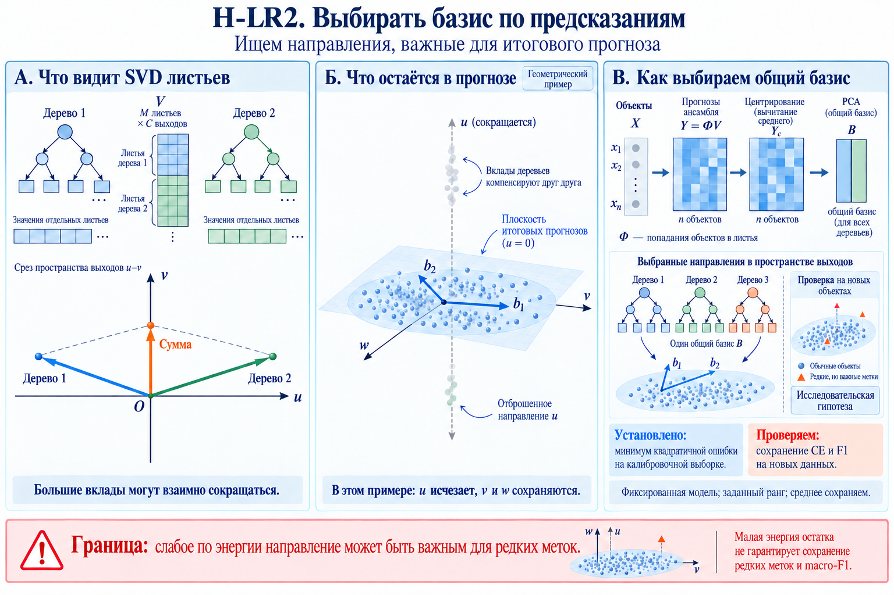

Исправленная версия v2. На обучающих объектах Y = ΦV: вклады отдельных деревьев могут компенсироваться, поэтому SVD значений листьев и PCA прогнозов решают разные задачи. Здесь H-LR2 — название постановки от 15 октября, а не поздней серии адресности остатка. Минимум ошибки реконструкции при фиксированном ранге и сохранённом среднем не гарантирует сохранения macro-F1.

## matched-budget-v2

**H-LR3: больше деревьев при сопоставимом бюджете.** Иллюстрация механизма или гипотезы. [PR #10](https://github.com/leostre/Py-Boost/pull/10).

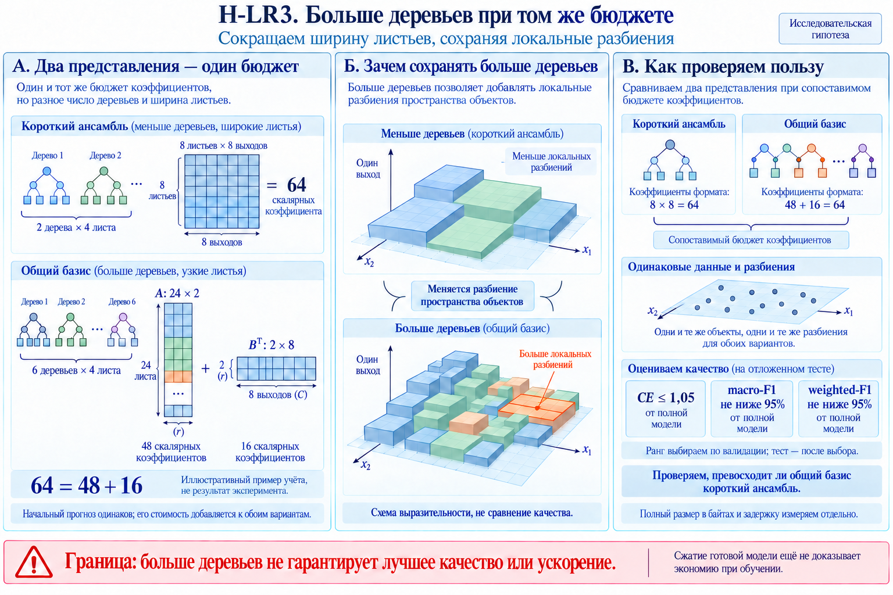

Исправленная версия v2. Пример 64 = 48 + 16 считает только скалярные коэффициенты; одинаковый размер всей модели из него не следует. Топология, индексы и рабочие буферы учитываются отдельно. Допуск 5% на рисунке относится к своему полному контролю AB + L; в H-QB1 сравнение с TabPFN проводится по кривым качества, без такого обязательного фильтра.

## sparse-corrections

**H-LR4: общий базис и разреженные поправки.** Иллюстрация механизма или гипотезы. [PR #7](https://github.com/leostre/Py-Boost/pull/7).

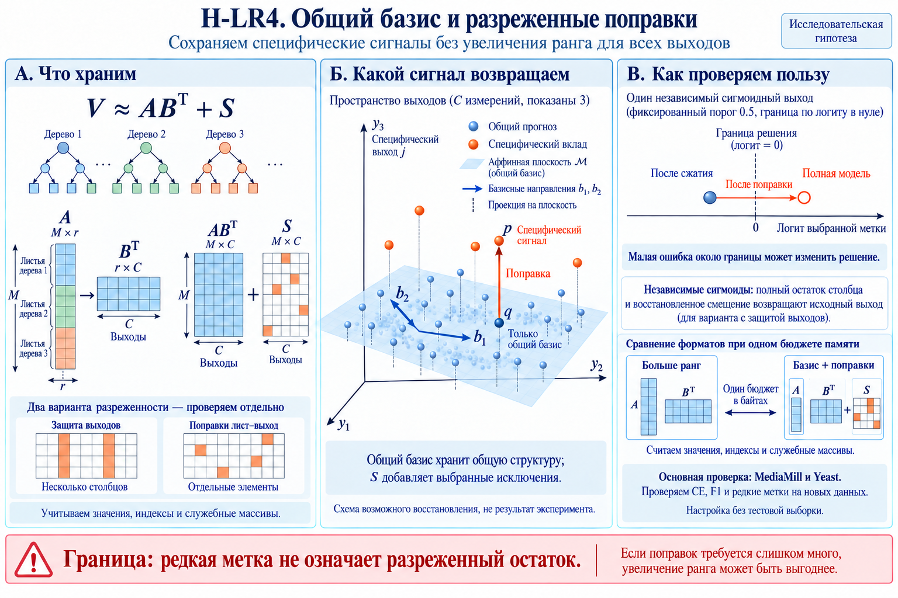

S на этом рисунке обозначает тот же разреженный остаток, который в других схемах назван L. Защита целых выходов и выбор отдельных координат лист–выход — разные варианты. Пример пересечения границы относится к независимому сигмоидному выходу: восстановление одного столбца не гарантирует сохранения многоклассового argmax. Координаты, значения, смещение и пороги оплачиваются в бюджете.

## traversal-v2

**Обход деревьев и распределение работы CUDA.** Иллюстрация механизма или гипотезы. [PR #8](https://github.com/leostre/Py-Boost/pull/8).

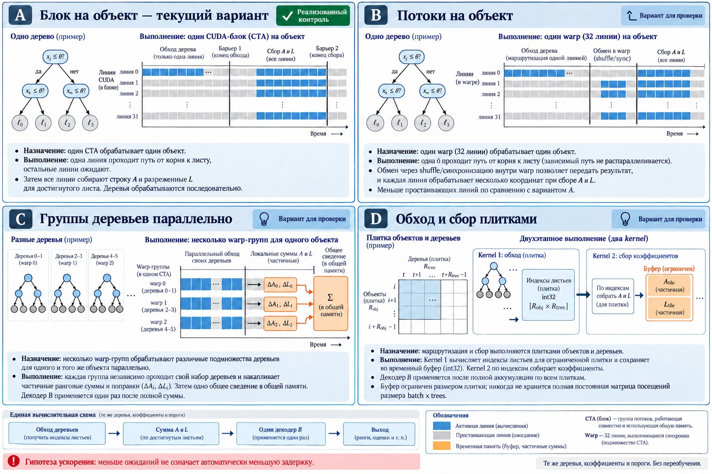

Сопоставляются блок на объект, warp на объект, группы деревьев и двухстадийный обход плитками. Зависимый путь по узлам не исчезает. Для двухстадийной схемы хранится ограниченная плитка индексов листьев, а не полная постоянная матрица посещений. Пометки «для проверки» отражают момент подготовки рисунка; актуальные реализации и ограничения измерений указаны в PR.

## joint-budget-v2

**Совместное управление листьями, рангом и остатком.** Иллюстрация механизма или гипотезы. [PR #10](https://github.com/leostre/Py-Boost/pull/10).

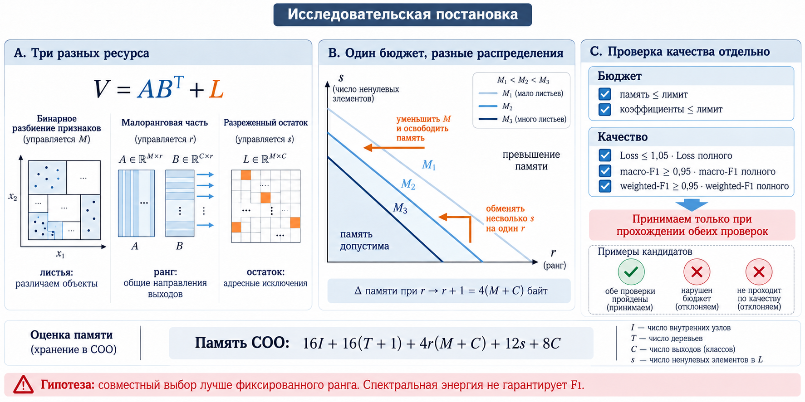

Для компактного представления Ṽ = ABᵀ + L сравниваются разные распределения одних и тех же ресурсов. Формула COO относится к конкретному формату массивов: 16I + 16(T + 1) + 4r(M + C) + 12s + 8C байт. CSR, пик процесса и размер файла имеют отдельный учёт. Память и качество должны пройти независимые проверки; условные кривые допустимости не являются результатом измерений.

## online-training-v2

**Сжатие после обучения и компактная обратная связь.** Иллюстрация механизма или гипотезы. [PR #9](https://github.com/leostre/Py-Boost/pull/9).

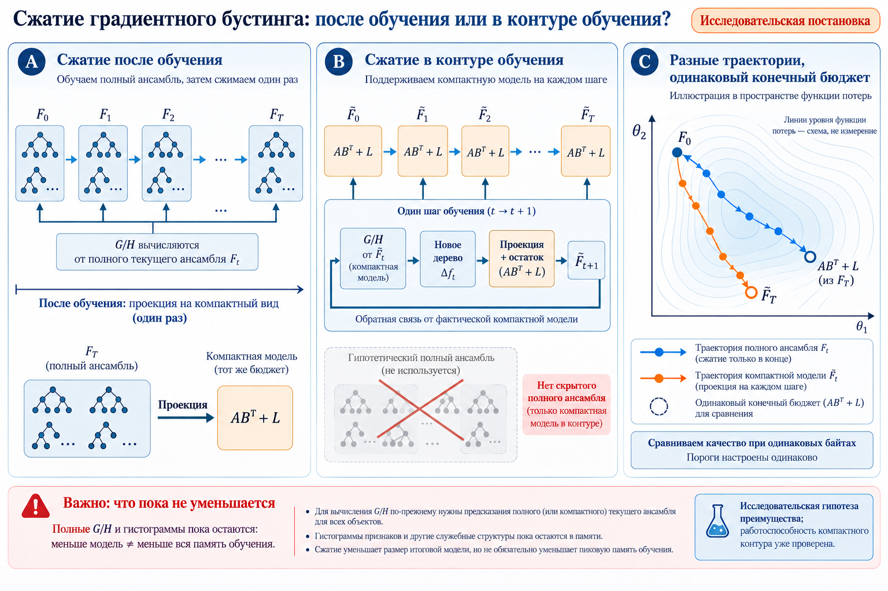

В компактном контуре новые G/H вычисляются от фактического сжатого ансамбля. Скрытая полная модель для этого не используется. Полные временные G/H и гистограммы пока остаются, поэтому меньшая конечная модель не означает меньшего общего пика обучения. Нарисованные траектории и их порядок по качеству иллюстративны.

## history-v2

**Текущий сигнал, среднее и история матриц Грама.** Иллюстрация механизма или гипотезы. [PR #9](https://github.com/leostre/Py-Boost/pull/9).

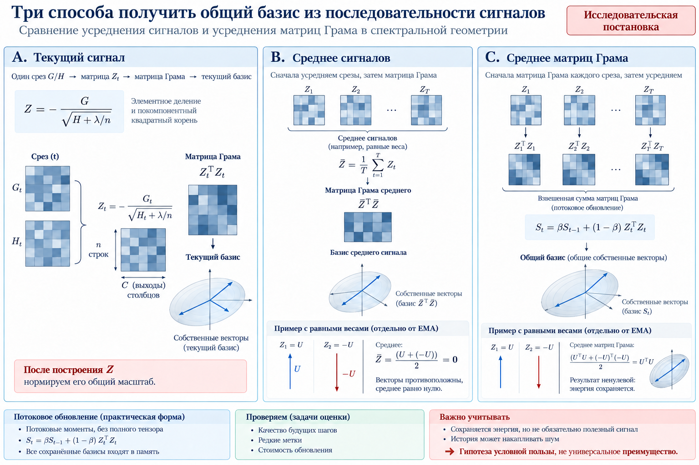

Сравниваются ZₜᵀZₜ, матрица Грама среднего сигнала и взвешенное среднее матриц Грама. Пример U, −U относится к равным весам, не к произвольной EMA. На практике существенны нормировка массы и начальное состояние. Потоковая матрица C × C не равна полному CP/Tucker-разложению тензорной истории. Сохранение энергии не гарантирует полезности базиса для классификации.

## parallel-branches-v2

**Параллельные приращения и общий базис.** Иллюстрация механизма или гипотезы. [PR #9](https://github.com/leostre/Py-Boost/pull/9).

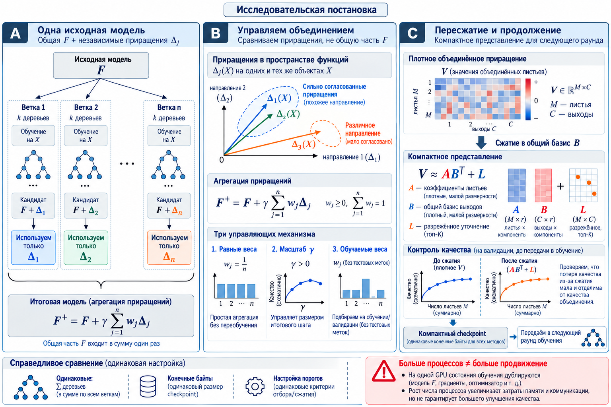

Общая часть F учитывается один раз: F⁺ = F + γΣⱼwⱼΔⱼ. Сравниваются именно новые приращения на одинаковых объектах, а не координаты разных листьев. Схема охватывает исследовательские альтернативы, включая обучаемые веса; она не утверждает, что все они проверены или полезны. Проведённые контроли и отрицательные результаты перечислены в PR.

## serving-memory-v2

**Память представления, запроса и нескольких моделей.** Иллюстрация механизма или гипотезы. [PR #8](https://github.com/leostre/Py-Boost/pull/8), [PR #11](https://github.com/leostre/Py-Boost/pull/11).

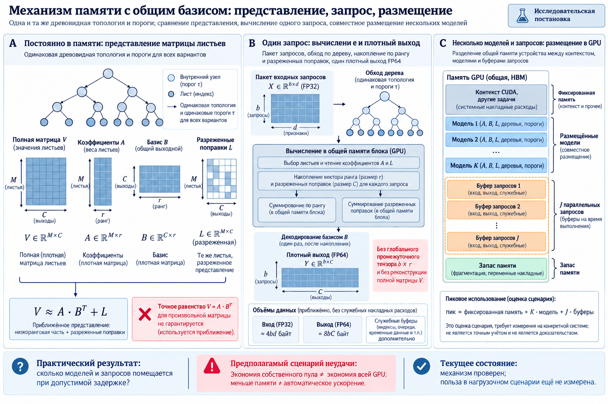

Достигнутые строки A и L накапливаются без восстановления полной матрицы V; в едином ядре нет глобального промежуточного массива батч × ранг. Плотный выход всё равно нужен; FP64 на рисунке — контракт измеренной версии ядра. Формула размещения нескольких моделей является оценкой сценария, а не измеренным пиком всего сервиса. Меньшие обслуживающие массивы не доказывают роста физической вместимости.

## Серия 29 октября 2026 года

[Инфографика для команды и 15 научных графиков](../2026-10-29/README.md). Качество при ограниченной памяти, ускорение той же функции модели и размещение банка показаны как отдельные сравнения.
