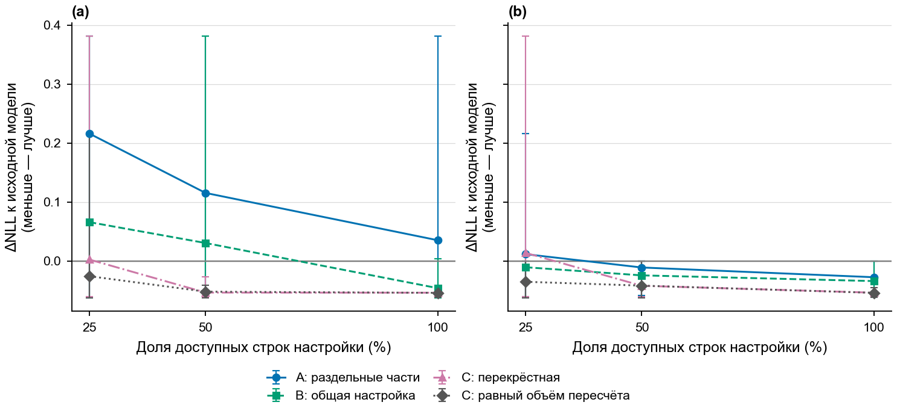
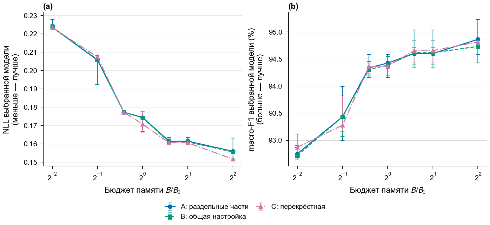

# H-CAL1: измеренные эффекты схем калибровки

Неизменённые рисунки завершённой и проверенной серии от 23 октября 2026 года. Используются прежние модели и тест. A — раздельные части, B — общая настройка, C — перекрёстная схема; доли доступных строк — 25%, 50%, 100%.

| Задача | Фиксированная PyBoost d5-t200 | Выбор ансамбля при бюджете |
|---|---|---|
| Helena | [PNG](cal1/helena_1204-fixed-calibration.png) · [SVG](cal1/helena_1204-fixed-calibration.svg) | [PNG](cal1/helena_1204-budget-selection.png) · [SVG](cal1/helena_1204-budget-selection.svg) |
| MNIST | [PNG](cal1/mnist_3104-fixed-calibration.png) · [SVG](cal1/mnist_3104-fixed-calibration.svg) | [PNG](cal1/mnist_3104-budget-selection.png) · [SVG](cal1/mnist_3104-budget-selection.svg) |
| RT-IoT2022 | [PNG](cal1/rt_iot2022_3204-fixed-calibration.png) · [SVG](cal1/rt_iot2022_3204-fixed-calibration.svg) | [PNG](cal1/rt_iot2022_3204-budget-selection.png) · [SVG](cal1/rt_iot2022_3204-budget-selection.svg) |
| WDBC | [PNG](cal1/wdbc_4104-fixed-calibration.png) · [SVG](cal1/wdbc_4104-fixed-calibration.svg) | [PNG](cal1/wdbc_4104-budget-selection.png) · [SVG](cal1/wdbc_4104-budget-selection.svg) |
| Banknote | [PNG](cal1/banknote_4204-fixed-calibration.png) · [SVG](cal1/banknote_4204-fixed-calibration.svg) | [PNG](cal1/banknote_4204-budget-selection.png) · [SVG](cal1/banknote_4204-budget-selection.svg) |

## Что означает разброс

Отрезки показывают наблюдаемый минимум и максимум десяти повторов разделения данных разработки. Это не доверительные интервалы и не десять независимых обучений или внешних разбиений. Внешнее train/test-разбиение одно на задачу. При 100% схема C окончательно пересчитывает температуру на одной и той же полной D; нулевой разброс температуры здесь не доказывает независимой устойчивости.

В `fixed-calibration` панель (a) применяет температуру обязательно, панель (b) выбирает между температурой и исходными выходами на данных разработки. Серая линия сохраняет выбор политики C, но выравнивает число объектов окончательного пересчёта с A/B. Одинаковые проценты не означают одинакового числа строк каждого вызова настройки.

В `budget-selection` NLL и macro-F1 принадлежат двум отдельным отборам. Все решения зафиксированы до теста. Одинаковый верхний предел памяти не означает одинакового её заполнения. Улучшение NLL не гарантирует улучшения macro-F1.

## Пример риска: WDBC

Отдельная маленькая часть настройки давала тяжёлые выбросы; проверочный отказ от температуры уменьшал вред, но не гарантировал защиты на малой доле данных.

## Пример выбора по бюджету: MNIST

Рисунок показывает поведение ранее зафиксированного отбора, а не результат новой настройки по тесту.
