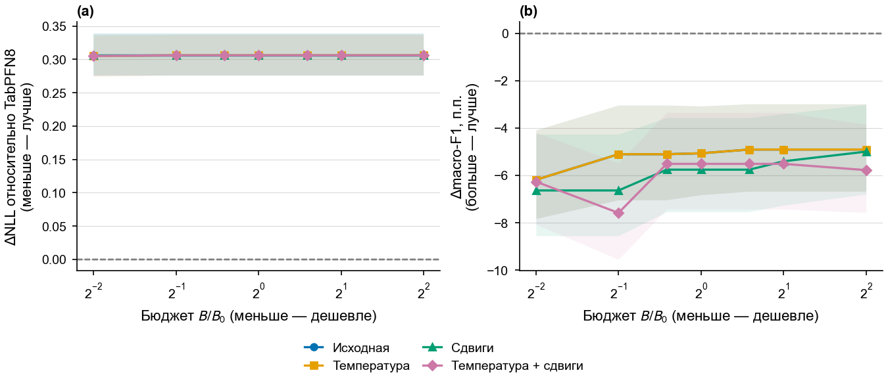

# H-QB1: измеренные кривые качества и бюджета

Неизменённые рисунки завершённой серии от 22 октября 2026 года. Это прежние результаты на одном внешнем разбиении каждой задачи; новых запусков при публикации нет. Проверки кода и протокол находятся в [PR #12](https://github.com/leostre/Py-Boost/pull/12).

| Задача | PyBoost и TabPFN | Кандидаты на данных отбора | CatBoost/XGBoost и TabPFN |
|---|---|---|---|
| Helena | [PNG](qb1/helena_1204-pyboost-test.png) · [SVG](qb1/helena_1204-pyboost-test.svg) | [PNG](qb1/helena_1204-development.png) · [SVG](qb1/helena_1204-development.svg) | [PNG](qb1/helena_1204-native-test.png) · [SVG](qb1/helena_1204-native-test.svg) |
| MNIST | [PNG](qb1/mnist_3104-pyboost-test.png) · [SVG](qb1/mnist_3104-pyboost-test.svg) | [PNG](qb1/mnist_3104-development.png) · [SVG](qb1/mnist_3104-development.svg) | [PNG](qb1/mnist_3104-native-test.png) · [SVG](qb1/mnist_3104-native-test.svg) |
| RT-IoT2022 | [PNG](qb1/rt_iot2022_3204-pyboost-test.png) · [SVG](qb1/rt_iot2022_3204-pyboost-test.svg) | [PNG](qb1/rt_iot2022_3204-development.png) · [SVG](qb1/rt_iot2022_3204-development.svg) | [PNG](qb1/rt_iot2022_3204-native-test.png) · [SVG](qb1/rt_iot2022_3204-native-test.svg) |
| WDBC | [PNG](qb1/wdbc_4104-pyboost-test.png) · [SVG](qb1/wdbc_4104-pyboost-test.svg) | [PNG](qb1/wdbc_4104-development.png) · [SVG](qb1/wdbc_4104-development.svg) | [PNG](qb1/wdbc_4104-native-test.png) · [SVG](qb1/wdbc_4104-native-test.svg) |
| Banknote | [PNG](qb1/banknote_4204-pyboost-test.png) · [SVG](qb1/banknote_4204-pyboost-test.svg) | [PNG](qb1/banknote_4204-development.png) · [SVG](qb1/banknote_4204-development.svg) | [PNG](qb1/banknote_4204-native-test.png) · [SVG](qb1/banknote_4204-native-test.svg) |

## Как читать графики

В `pyboost-test` слева показана разность NLL с TabPFN8, справа — разность macro-F1 в процентных пунктах. Модели двух панелей отобраны по разным критериям и могут различаться. Каждая процедура обработки выходов сравнивается с такой же процедурой TabPFN. Ось бюджета задаёт разрешённый верхний предел B/B₀ относительно прежней PyBoost d5-t200, а не обязательно фактический размер выбранной модели.

Заливка — 95%-й парный бутстрэп-интервал для зафиксированной пары, 500 повторов тестовых строк с полной областью классов. Это не разброс новых обучений. Линии соединяют дискретные точки, а промежуточные бюджеты не проверялись. Многократно использованный тест остаётся разведочным.

В `development` показаны все кандидаты на части отбора; граница недоминируемых решений не является тестовой огибающей. В `native-test` сложность измеряется коэффициентами листьев, а не памятью или временем. Многоклассовая итерация XGBoost может добавлять несколько скалярных деревьев.

Эти графики не измеряют вместимость работающего сервиса. Файлы внешних моделей и контекста TabPFN не приравниваются к резидентной памяти. Допуск 5% относительно TabPFN не используется как обязательный фильтр этой серии.

## Пример: Helena

Показан также случай без победы над TabPFN: ось NLL выше нуля, macro-F1 — ниже. Иллюстрации не отбираются только по положительному исходу.
