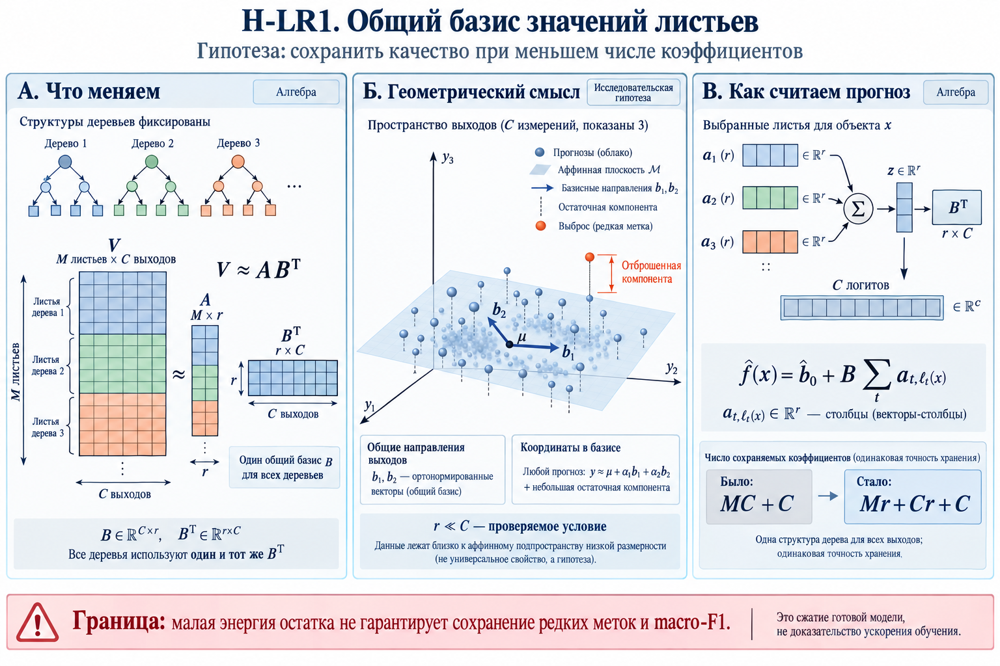
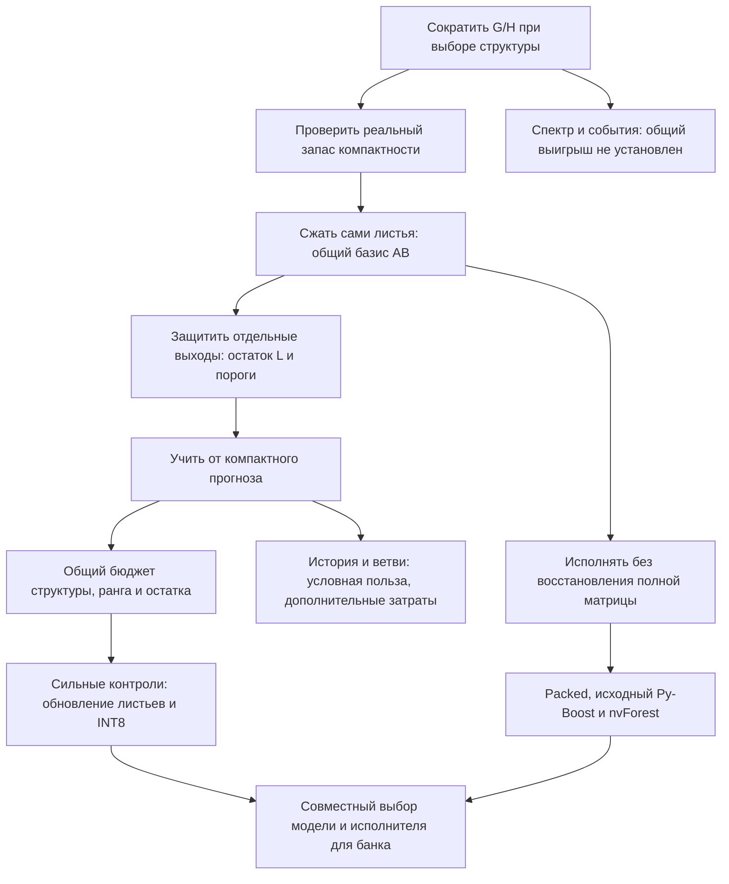
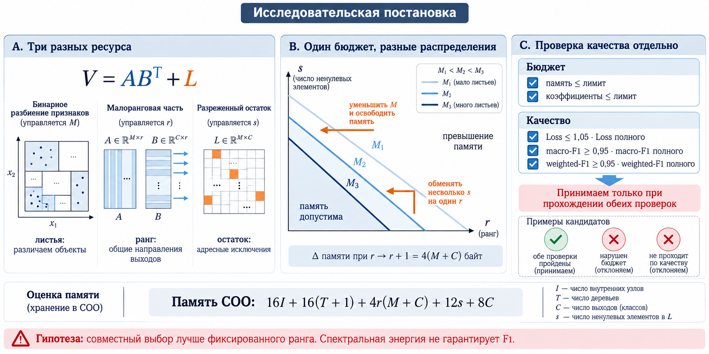

# HASBoost: как менялась исследовательская постановка

Этот документ объясняет, зачем появились изменения в PR, какие результаты меняли следующий вопрос и какие варианты не оправдали ожиданий. Это история зафиксированных гипотез, проверок и решений по протоколам и отчётам, а не дословная стенограмма обсуждений. Отрицательный результат конкретной реализации не объявляется опровержением всего направления.

**Главная идея проекта:** для многих задач ансамбль можно сделать компактнее, сохранив полезное качество. Исследовательская задача — научиться распределять ограниченные ресурсы между структурой деревьев, общими направлениями выходов и адресными поправками. Практическая задача — исполнять такое представление без восстановления большой полной модели.

Новому участнику удобно сначала открыть [интерактивный прототип](../2026-10-29/hasboost-results-interactive.html), затем прочитать разделы 1–3 и выбрать интересующую траекторию в истории. GitHub показывает исходный HTML; для работы его нужно скачать и открыть в браузере. Данные и изображения встроены, сервер не требуется.

Для объяснения инференса добавлен [анимированный путь батча](animations/README.md): управляемый плеер в HTML, отдельные GIF и анимированные SVG. Он показывает получение входа, передачу, выбор листьев, накопление и возврат результата. Использованы явно обозначенные учебные числа; это не новые измерения проекта.

Навигация: [основные различия](#1-три-вопроса-которые-нельзя-смешивать) · [математический объект](#2-что-именно-мы-сжимаем) · [история решений](#3-история-изменений-гипотез) · [неудачные ветки](#4-какие-направления-не-стали-общим-решением) · [PR и источники](#6-как-документ-связан-с-кодом-и-доказательствами).

## 1. Три вопроса, которые нельзя смешивать

| Вопрос | Что меняется | Что само по себе ещё не следует из результата |
|---|---|---|
| Можно ли дешевле выбрать структуру дерева? | Объём G/H, используемый при поиске разбиений | Что в готовой модели станет меньше коэффициентов |
| Можно ли компактнее представить ансамбль? | Листья, число деревьев, ранг, остаток, формат чисел | Что запрос станет быстрее или уменьшится весь пик обучения |
| Можно ли эффективнее вычислить тот же прогноз? | Упаковка, обход деревьев, рабочие буферы, CUDA-запуски | Что улучшилась статистическая модель или качество |

Изначально эти вопросы были тесно связаны в одной идее скетчинга. Эксперименты потребовали развести их. Например, можно выбирать структуру по половине выходов, а затем хранить в каждом листе значения для всех выходов. Это сокращение работы поиска, но ещё не сжатие модели. И наоборот, меньше коэффициентов не гарантирует меньшую задержку, если их обработка создаёт дополнительные массивы и запуски.

Рисунок — ранее подготовленная концептуальная схема H-LR1, **не график измерений**. В нём B имеет форму C × r и используется Bᵀ; ниже ради прямой записи вычислений B обозначает уже декодер r × C. Это соглашения о записи одного механизма.

## 2. Что именно мы сжимаем

Пусть M — суммарное число листьев, C — число выходов. Полная матрица листовых значений V имеет размер M × C. Рассматриваем приближение:

$$
V \approx \widetilde V=AB+L,\qquad
A\in\mathbb R^{M\times r},\quad B\in\mathbb R^{r\times C}.
$$

A хранит координаты листьев в общем базисе, B восстанавливает полный вектор выходов, L содержит выбранные дополнительные коэффициенты. Равенство относится к **новой сжатой модели** Ṽ, а совпадение с исходной V проверяется приближённо. В блочной модели у разных участков ансамбля свои Aₖ/Bₖ/Lₖ; часть старых прямых вариантов также хранит полное начало из 40 деревьев.

Для объекта x в каждом дереве определяется лист ℓₜ(x). В одном блоке прогноз вычисляется так:

$$
\widetilde F_k(x)=
\left(\sum_{t\in k} A_{t,\ell_t(x),:}\right)B_k
+\sum_{t\in k}L_{t,\ell_t(x),:}.
$$

Суммируются **координаты достигнутых листьев**, а не вся матрица A. Базис применяется к сумме. Это позволяет не восстанавливать Ṽ целиком. Для нескольких блоков складываются их приращения и общий начальный прогноз. Порог применяется после получения вероятностей и не является частью разложения матрицы листьев.

Счёт коэффициентов r(M+C)+s вместо MC полезен для оценки, но фактический бюджет шире:

$$
\mathcal B_{\rm model}=
\mathcal B_{\rm structure}+\mathcal B_{\rm full\ leaves}
+\sum_k\left(b_A M_k r_k+b_B r_k C+
\mathcal B_{\rm sparse}(s_k)\right)
+\mathcal B_{\rm policy}+\mathcal B_{\rm metadata}.
$$

Здесь bA/bB — байты одного коэффициента. Разреженные поправки оплачивают также индексы; INT8 — масштабы; политика выходов — смещения и температуру. Для размещения банка добавляются рабочие массивы запросов, выравнивание и конкурентность. Это прикладной бюджет, а не вся память процесса вместе с драйвером и CUDA-контекстом.

Из формулы следуют три различающихся способа потратить память: сохранить больше разбиений, увеличить число общих направлений или добавить адресные коэффициенты. Но **формула не выбирает лучший способ по качеству**. Малый остаток по энергии может содержать важную редкую метку; больше листьев может давать полезную неоднородность; поправка может переобучаться.

## 3. История изменений гипотез

Ветки ниже расположены по появлению вопроса и могут пересекаться во времени. Например, работа над исполнителем продолжалась и после первых экспериментов компактного обучения. Новая версия критерия не пересчитывает задним числом старую серию.

### Этап A. Сначала — согласовать смысл реализации

**Постановка.** Скетчинг должен менять используемые для поиска статистики, сохраняя корректный смысл строк, признаков и выходов. После выбора структуры окончательные листья пересчитываются по полным статистикам.

**Проверка и изменение.** Разведены индексаторы объектов, признаков и выходов, выбор структуры и расчёт листьев. Формализованы инварианты pᵢ/qⱼ и полного пересчёта. Численная воспроизводимость GPU-редукций выделена в отдельную задачу.

**Вывод → следующий вопрос.** Наличие исправления не доказывает преимуществ идеи по качеству или скорости. Сначала нужен корректный контроль, затем сравнение при одинаковом ресурсе. Эти изменения легли в [HBP-01–03](../README.md), PR [#3](https://github.com/leostre/Py-Boost/pull/3)–[#5](https://github.com/leostre/Py-Boost/pull/5). Они не заменяют последующих экспериментов. Источники: S01, S13.

### Этап B. История G/H должна подсказать, когда и что сокращать

**Постановка.** Сохранять G/H по времени, оценивать воспроизводимость состояния и держать подтверждённый бюджет несколько деревьев. Ранняя активация после одной точки истории считалась подозрительной: хотелось отличить устойчивое состояние от краткого изменения.

**Проверка.** Сопоставлялись текущий сигнал, усреднение, история профилей и событийные проверки. Более поздний детектор проверялся против периодического при равном числе контрольных вычислений. На пригодных Birds он пропустил три опасных состояния против одного у периодического контроля.

**Вывод → следующий вопрос.** Текущий детектор не стал более надёжным. Это ограничение выбранного сигнала и правила, а не доказательство бесполезности удержания бюджета. Низкая энергия и низкий ранг не гарантируют сохранения конкретного разбиения и F1. Полное тензорное разложение истории нельзя считать выполненным на основании анализа средних матриц Грама. См. [HBP-04](../04-spectral-events.md), PR [#6](https://github.com/leostre/Py-Boost/pull/6); S01, S02, S13.

### Этап C. От «похожих разбиений» — к качеству при меньшей сложности

**Постановка.** Возможно, ансамбль избыточно сложен для задачи. Тогда точное совпадение с полным поиском не обязательно: важнее кривая качества относительно реального размера.

**Результат серии 28 сентября.** Простые ограничения глубины, числа деревьев и регуляризация показали заметный запас сокращения. Добавочное преимущество Top-K и спектрального контроллера оказалось неоднородным. На MNIST некоторые режимы не проходили общий допуск, хотя на Birds и RT-IoT работали лучше. Выяснилось также, что доля от теоретического максимума листьев не равна той же доле от фактической полной модели.

**Вывод → следующий вопрос.** Запас компактности существует в проверенной сетке, но его наличие не является доказательством успеха нового регулятора. Простые небольшие ансамбли и регуляризация становятся обязательными контролями. Номинальный бюджет заменяется фактическим. Источник S02; эта H1–H5 — нумерация сентябрьского цикла, а не прежние H5-1/H5-2/H5-3 и не позднейшие R1–R6.

### Этап D. Общий базис значений листьев

**Постановка H-LR1.** Если выходы используют общие направления, можно сжимать не только статистики поиска, но и сами хранимые значения листьев. Структуры деревьев сохраняются; V заменяется на AB.

**Результат.** Экономия коэффициентов оказалась реальной, но macro-F1 мог падать заметнее средней функции потерь. Редкие метки и решения около порога плохо описываются одним критерием восстановления энергии. При малом числе выходов само пространство возможного сокращения уже невелико.

**Вывод → следующий вопрос.** Общий базис работоспособен, но одного глобального ранга недостаточно. Возникла гибридная постановка: оставить основные направления в AB, а трудно сжимаемые пары «лист — выход» поддержать через L. Источник S03, [HBP-05](../05-low-rank-residual.md), PR [#7](https://github.com/leostre/Py-Boost/pull/7).

### Этап E. Разреженный остаток, пороги и ненадёжный отбор

**Постановка H-LR4.** Небольшое число поправок должно восстановить потерянные ответы дешевле простого увеличения ранга. Остатки 1/2/5% сопоставлялись с рангом и настройкой выходов при учёте коэффициентов и памяти. Поддержка поправок выбирается без тестовой разметки.

**Результат.** Гибрид и настройка порогов помогали, но эффект различался по наборам. Последующие парные проверки и более устойчивый отбор не устранили все неудачи MediaMill. Контроль поддержки меток в разбиении не дал ожидаемого общего исправления. Различие между D и тестом оставалось существенным.

**Вывод → следующий вопрос.** Нельзя объяснять все потери отсутствующими редкими метками или считать бутстрэп гарантией переноса. Вероятностную калибровку, выбор порогов и собственно сжатие нужно сравнивать отдельно; всем моделям нужна одинаковая возможность настройки. Источники S04, S13. Эта ветка изменила протокол, но не доказала, что любую потерю AB можно исправить малым L.

### Этап F. Почему компактная модель сначала не была быстрой

**Постановка.** Из AB + L кажется естественным ожидать меньше вычислений. Первые реализации, однако, собирали промежуточные массивы, отдельно обрабатывали остаток и декодировали базис.

**Результат.** Основная стоимость оказалась в обходе деревьев и сборе значений, а не в одном умножении на B. Последовательно убирались пересборка CSR и матрицы посещений, отдельные буферы, затем глобальное промежуточное состояние «батч × ранг». Единое ядро снизило собственный пик гибрида примерно на 13–20% относительно оптимизированного полного варианта в прежней серии; измерения на разделяемой A100 ещё не доказывали устойчивого ускорения.

**Вывод → следующий вопрос.** Представление и исполнитель — разные факторы. Понадобились полная модель на таком же оптимизированном ядре, исходный Py-Boost и раздельные времена GPU/всего запроса. Термин legacy здесь означает **уже оптимизированный прежний блочный путь**, а не исходный `master`. Источники S05, S15; [HBP-06](../06-inference.md), PR [#8](https://github.com/leostre/Py-Boost/pull/8).

### Этап G. Сжатие внутри обучения, история и параллельные ветви

**Постановка.** Если следующий градиент вычисляется от сжатого ансамбля, новые деревья могут компенсировать его ошибку. История G/H могла дать лучший базис, а несколько коротких ветвей — несколько полезных направлений для объединения.

Связь с GaLore здесь методологическая: переносится идея обновляемого пространства приращений. Состояния Adam, матрицы параметров нейросетевого слоя и оценки их памяти не переносятся на бустинг автоматически. Поэтому сравниваются текущий сигнал, среднее и история при одинаковом ранге и периоде обновления, а не заявляется воспроизведение нейросетевого оптимизатора. Источник S18.

**Результат серии 19 октября.** Фиксированный гибрид прошёл прежний совместный критерий на всех разбиениях Yeast и Helena, на MediaMill — на двух из пяти. История улучшила macro-F1 на Yeast относительно текущего сигнала во всех пяти разбиениях; общего преимущества на двух других задачах не было. Усреднение двух коротких ветвей не стало универсальным улучшением. Последовательное пересжатие на MediaMill прошло критерий в четырёх случаях из пяти против двух у фиксированного гибрида.

**Вывод → следующий вопрос.** Компактная обратная связь реализуема, но её особая польза сверх сжатия после обучения ещё не доказана в общем случае. История стоит ресурсов, а объединение ветвей должно учитывать эффективный шаг и общую часть ансамбля. Средние матрицы Грама не являются полным CP/Tucker-разложением временного тензора. Источник S05, [HBP-07](../07-compact-training.md), PR [#9](https://github.com/leostre/Py-Boost/pull/9).

На рисунке сохранён **исторический допуск 5%**. С 28 октября он перестал быть общим исследовательским отсечением: стали изучаться кривые и границы применимости. Равенство в старом рисунке относится к сжатому представлению, а не к точному равенству исходной полной модели.

### Этап H. Совместный бюджет и правило остановки

**Постановка.** Один ранг не контролирует сложность: модель может нарастить листья или несколько базисов. Регулятор должен различать пользу следующего шага, накопленную ошибку относительно полной модели и оставшуюся память.

**Проверка.** Введены отдельные условия для этих трёх величин и резерв будущей топологии. В прежней серии на восьми задачах регулятор с резервом проходил совместный критерий в 30/40 случаях, без резерва — в 26/40; обычный небольшой ансамбль — в 28/40. Позже новое правило сначала воспроизводилось на сохранённых приращениях. Когда правило выбирало ранее отклонённую ветку, её будущие деревья считались неизвестными, а не заимствовались из другой траектории. Для MediaMill и MNIST это потребовало отдельной серии новых деревьев.

**Вывод → следующий вопрос.** Корректная остановка устраняет ошибку управления, но не гарантирует, что текущий каталог представлений содержит пригодное решение. Ошибка AB, недостаток разбиений и накопленное отставание требуют разных действий. Источники S07–S08, S13; [HBP-08](../08-joint-budget.md), PR [#10](https://github.com/leostre/Py-Boost/pull/10).

### Этап I. Экономнее использовать данные и изучать кривые

**Постановка.** Отдельные небольшие части для температуры, сдвигов, контроля и отбора слишком дорого расходуют малые наборы. Кроме того, жёсткое «прошёл/не прошёл 5%» скрывает форму обмена качества на память.

**Результат.** H-CAL1 сравнил три схемы на прежних моделях и долях D: общий набор уменьшал разброс температуры, перекрёстная схема помогала NLL-отбору, но не становилась общей победительницей macro-F1. Затем направления сжатия, калибровки и отбора объединили в постановку границ применимости. Потеря более половины F1 стала исследовательской нижней отметкой, а не новым обещанием допустимого качества.

**Вывод → следующий вопрос.** Нужны одинаковые схемы данных для конкурентов, возможность отказаться от калибровки и сравнение всей кривой. Смена схемы не превращает уже использованный тест в новый независимый. Источники S06, S09; [HBP-10](../10-calibration.md), PR [#12](https://github.com/leostre/Py-Boost/pull/12).

### Этап J. Адресные поправки, смешанные каталоги и широкий срез

**Постановка.** Общий резерв поправок на несколько деревьев должен распределяться туда, где он полезнее. В банке разрешается выбирать как компактный, так и обычный вариант. Метод должен проверяться на более широком наборе многометочных задач.

**Результат.** Адресность помогала не везде: на Emotions поправки могли лучше восстанавливать обучающую цель, но ухудшать отложенные NLL и F1. Потеря не сводилась к самым редким меткам; разреженность коэффициентов не означает узкого воздействия на объекты. Ослабление и возможность пропуска остатка стали отдельными вариантами. Широкая серия дала 4 941 представление и 1 008 заранее выбранных точек на 12 наборах / 36 train/D-разбиениях. При старой координате 0,25 B₀ прямые AB и AB + L имели положительный средний результат относительно обычного семейства на 10/12 наборах.

**Вывод → следующий вопрос.** Положительный широкий результат содержателен, но одинаковый потолок ещё не означает близкие фактические байты, а обновлённые обычные модели могут усилить контроль. Поправка не обязана присутствовать в каждом шаге; каталог должен содержать и простые варианты. Источники S10–S14; [прототип агрегации](../2026-10-29/hasboost-results-interactive.html), PR [#24](https://github.com/leostre/Py-Boost/pull/24).

### Этап K. Сильные контроли изменили трактовку выигрыша

**Постановка серии R1–R3.** Сопоставить близкие фактические массивы, сжать полное начало и проверить сокращение структуры с обновлением оставшихся листьев.

**Результат.** Все 288 пар R1 удалось сопоставить в пределах 5% байтов. При прежней группе 0,5 B₀ средняя разница macro-F1 составила +1,355 п.п. у AB и +0,472 п.п. у AB + L. Сжатый старт AB + L на 36 разбиениях занял в среднем 81,61% памяти прежнего AB + L при Δ −0,052 п.п.

Самым существенным новым контролем стали 50 выбранных деревьев с обновлением полных листьев: **26,0% памяти исходных 200 деревьев и −0,506 п.п. macro-F1** в среднем. При добавлении AB + L остаётся 16,8% памяти, потеря составляет 1,766 п.п. Относительно обычного префикса 50 обновление выбранных полных листьев даёт +2,355 п.п.

**Вывод → следующий вопрос.** Большая часть улучшения может приходить от перенастройки коэффициентов. Пользу правила выбора деревьев после одинакового обновления ещё нужно отделить контролем «обычный префикс + такое же обновление». Это не провал AB + L: оно даёт дополнительную ступень компактности, которую нужно оценивать относительно усиленного обычного метода. Источник S16, [числовой отчёт R1–R3](../2026-10-30/README.md).

### Этап L. Квантование: сильная экономия, но отдельный вопрос о скорости

**Постановка R5.** После сокращения числа коэффициентов уменьшить размер каждого числа, сохраняя прямое вычисление без разворачивания полной FP32-модели. Отдельно проверить, компенсирует ли продолжение обучения округление.

**Результат.** На первых разбиениях 12 наборов INT8 прежнего AB + L занимает 43,7% своих FP32-массивов; средняя Δ macro-F1 при прежних порогах −0,0050 п.п. Обычная полная модель тоже хорошо квантуется — до 35,0% своих массивов. После оптимизации декодера общего ускорения INT8 не получено. У собственного пика AB + L отношение INT8/FP32 около 40% при батче 1, но 96% при 1024: рабочие массивы начинают доминировать.

После округления B перестаёт быть ортонормальным. Для штрафа декодированных листьев исправлена метрика с λI на λBᵀB; независимая квадратичная проверка подтвердила формулу. Исправленное квантованное продолжение дало средние Δ −0,522 п.п. FP16 и −0,225 п.п. INT8 к продолжению с последующим квантованием. Предварительный вариант сохранён, но не продвигается как положительное подтверждение.

**Вывод → следующий вопрос.** Физическое квантование — практический компонент; квантованное продолжение пока не стало обязательным улучшением. Сжатые обычные листья являются сильным конкурентом AB + L. Источник S16, [таблицы кодеков](../2026-10-30/data/quantization.csv).

### Этап M. Инференс и несколько моделей в одном бюджете

**Постановка R4/R6.** Проверить, что даёт новая организация вычислений относительно исходного Py-Boost и современного исполнителя, затем учитывать рабочую память и качество набора моделей вместе.

**Результат.** При батче 1024 packed ускоряет p95 полного запроса исходной полной модели в медиане по 12 наборам в 4,88 раза. Против nvForest в режиме `single` с объединённым вычислением выходов отношение p95 nvForest/packed — 1,006, почти равенство; при 4096 — 0,830, в пользу nvForest. Все 180 предварительных решений выбрали packed вместо отдельного сбора с GEMM в проверенном диапазоне.

Все 240 проверок бюджета банков с рабочими буферами прошли. Смешанный каталог экономнее усиленного обычного, но последний лучше по среднему качеству. При прикладном лимите 64 МиБ физически размещены 468 копий моделей смешанного банка против 276 усиленного обычного; их качество различается, различных задач только 12, обслуживание сотен копий под нагрузкой не измерялось.

В прежней пятизадачной группе TabPFN в кэшированном режиме `auto` с восемью оценщиками значительно тяжелее готового бустингового банка по задержке: при равномерном потоке, батче 32 p95 335,93 против 0,347 мс. Качество не выровнено; TabPFN сильнее по macro-F1 на четырёх из пяти этих задач. Стоимость обучения деревьев не входит в задержку готового сервиса. Эти результаты не доказывают общего превосходства сжатых бустингов над фундаментальной моделью.

**Вывод.** На практике выбираются вместе представление, исполнитель, батч, политика выходов и состав банка. Экономия параметров — ресурс, а её превращение в скорость или дополнительные качественные модели требует самостоятельного измерения. Источники S15–S16, [инференс](../2026-10-30/data/inference_aggregate.csv), [банки](../2026-10-30/data/bank_serving.csv).

## 4. Какие направления не стали общим решением

| Проверенная сильная версия | Что ограничило её | Что остаётся открытым |
|---|---|---|
| Низкий спектральный ранг сам задаёт безопасный бюджет | Энергия не контролирует редкие метки и ошибку решения | Диагностическая роль спектра и условные метаправила |
| Событийная проверка надёжнее периодической при той же цене | Конкретный детектор пропускал больше опасных состояний | Другие сигналы и удержание бюджета как общий принцип |
| Адресная поправка всегда полезна | Ухудшение отложенных метрик даже при лучшем обучающем приближении | Ослабление, пропуск и регуляризация по задаче |
| Стратификация и бутстрэп устранят ошибки выбора | Межвыборочное различие не исчезло | Новые независимые проверки и экономная перекрёстная оценка |
| История всегда лучше текущего градиента | Польза на Yeast не стала общей, есть накладные расходы | Группы задач и полный анализ временной структуры |
| Усреднение коротких ветвей даст более сильный шаг | Общего выигрыша не было | Контроль эффективного шага и разнообразия приращений |
| Меньше байтов означает быстрее инференс | Обход, запуски, передачи и рабочие буферы могут доминировать | Диспетчер по измеренной полной задержке |
| Сжатие скомпенсирует любой проигрыш TabPFN | Не выровнены качество и сценарии; сильные обычные контроли | Кривые «качество — стоимость — задержка» для реальных задач |

Термины «отложено», «не стало общим улучшением» и «не проверено» здесь различаются. Полная тензорная история, перенос в SamplingZoo/Fedot.Industrial и общее правило выбора метода по метахарактеристикам не считаются доказанными. Дальнейшие обучения этим документом не запускаются.

## 5. Что можно считать текущей методологией

1. Разделять **поиск структуры, хранимую модель, политику выходов и исполнение**. Сравнивать их совместно можно, но подпись обязана назвать изменившиеся факторы.
2. Показывать кривую и точные байты. Сохранять и меньшие обычные модели, и обновлённые листья, и их квантование. Одинаковый потолок, число коэффициентов и фактический размер — разные условия.
3. Подбирать на D, оценивать на тесте. Повторное использование теста прямо помечать как разведочную проверку. Три разбиения с общим тестом не считать тремя независимыми задачами.
4. Разделять качество вероятностей и качество меток. Сравнивать одинаковую возможность настройки; допускать отказ от температуры, сдвига и остатка.
5. Не переносить будущие деревья между различающимися состояниями ансамбля при воспроизведении нового регулятора. Неизвестное продолжение сохранять как неизвестное.
6. Для скорости указывать модель, UID, батч, исполнителя, границу времени, состояние GPU и арифметику. Ускорение одной модели не выдавать за преимущество другой; p95 потока — за медиану отношений по задачам.
7. Для банка оплачивать параметры, индексы, масштабы, рабочие массивы и конкурентность. Различать фактические копии, число разных задач и измеренную обслуживающую нагрузку.

Наиболее содержательное продолжение после ревью — общий выбор структуры, полных или AB + L листьев, остатка и формата хранения при требовании к полной задержке. Следующий различающий контроль — одинаковое обновление листьев у выбранных деревьев и обычного префикса. Затем нужны новые тесты: расширять только число повторов на знакомых тестах недостаточно.

## 6. Как документ связан с кодом и доказательствами

| Публикация | Смысл |
|---|---|
| [PR #3–12 и HBP-01–10](../README.md) | Корректность, измерения, спектр, AB + L, исполнение, обучение, бюджет, внешние контроли и калибровка |
| [PR #24](https://github.com/leostre/Py-Boost/pull/24) | Широкая многометочная серия и первый интерактивный прототип |
| [PR #28](https://github.com/leostre/Py-Boost/pull/28) | Близкие фактические байты, сильное обновление листьев, кодеки, nvForest и банки |
| [Карта модулей R1–R7](../../../research/external_controls/SIX_DIRECTIONS.md) | Где реализован каждый новый механизм |
| [Источники этого документа](source-map.json) | S01–S18: названия, охват, SHA-256; `vault` означает локальную историческую заметку, `repository` — доступный файл репозитория |
| [Числовые отчёты](../2026-10-30/source_manifest.json) | Закреплённые источники, идентификаторы запусков и хеши |
| [Прототип агрегации](../2026-10-29/hasboost-results-interactive.html) | Датасеты, кандидаты, парные сравнения, инференс, банки и новая галерея идей |

HTML включает **исторический срез** качества 29 октября и первую native-серию S2. Его числа не заменены новыми R1–R6: новые результаты находятся в отдельном отчёте и явно названы в этой истории. Источник HTML из указанной пользователем рабочей копии проверен по SHA-256 и сохранён неизменным; новая визуальная редакция выполнена в ветке PR #28. Концептуальные изображения объясняют устройство, но не являются доказательствами качества.

Все результаты — наблюдения в указанных условиях, не математические гарантии и не принятое решение о выпуске продукта. Статус документа — **review**; эксперименты завершены, приёмка и слияние остаются отдельными этапами.

[Проверки этой редакции](checks.json) · [реестр использованных визуализаций](visual-registry.csv). Прежние схемы сохранены без перерисовки; исторические обозначения и критерии уточняются подписями. Проверка Quartz не относится к этому репозиторию: материал собран как Markdown и автономный HTML.
